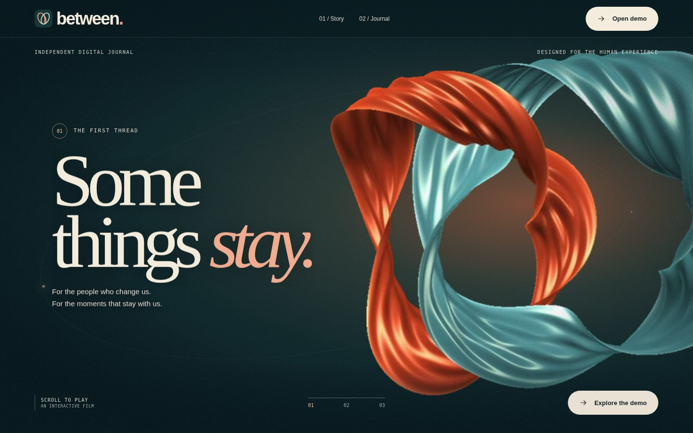
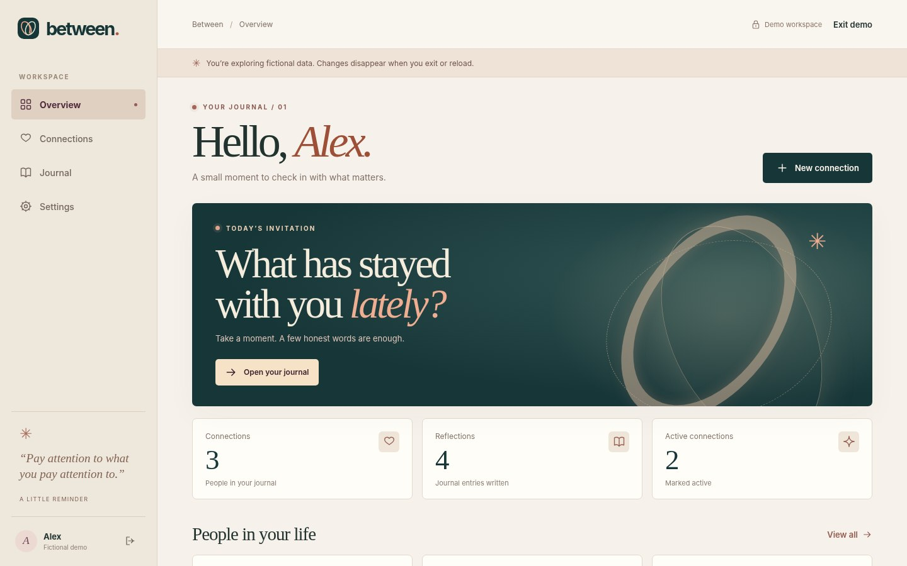
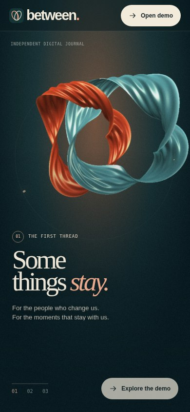

# BETWEEN — Director’s Cut

**A space for what matters.** A full-stack personal relationship journal and cinematic web experience, built as a software engineering portfolio project.



The application combines a Python API with a responsive, scroll-driven visual narrative. Try the fictional-data demo in the interface; no account is needed for demo mode.

## What I built and learned

I designed and developed the original Relationship Journal backend as a computer science student, working through database models, API endpoints, authentication, ownership checks, migrations and integration tests with AI mentorship. I then used AI-assisted development to extend the security architecture, session management, testing, documentation and cinematic frontend. I ran the project locally, tested its behavior and selected the final visual direction. This is an educational portfolio project, not independently audited production software.

## Highlights

- FastAPI REST API, PostgreSQL, SQLAlchemy, Alembic and Redis.
- Argon2 password hashing, JWT access tokens, database-backed refresh-token rotation, session revocation and IP-based rate limiting.
- Owner-scoped relationship and journal CRUD, filtering, search, pagination, dashboard counts, JSON export and password-confirmed account deletion.
- Original parametric ribbon geometry, GLSL shaders and scroll-linked WebGL rendering; a 108-frame WebP atlas fallback and reduced-motion layout.
- Native HTML, CSS and JavaScript; no frontend build step or external CDN required.
- 39 backend integration tests passed locally and Backend CI succeeded for the initial backend release. Frontend smoke checks were conducted separately; see [FRONTEND.md](FRONTEND.md) for scope and limitations.



## Architecture

```text
Browser / cinematic UI / fictional demo
                |
       Same-origin FastAPI
       /                  \
 PostgreSQL              Redis
 users, relationships    authentication
 journal, sessions       rate limits
```

Real authentication uses an in-memory browser access token and a server-issued HttpOnly refresh cookie. Keeping UI and API on the same origin avoids cross-site cookie dependencies. The public static showcase, when enabled, runs only on fictional demo data, not the API.

## Run locally

1. Install Python 3.12 and Docker. Create and activate a virtual environment; install `pip install -r requirements.txt`.
2. Copy `.env.example` to `.env` and configure the local database and Redis URLs. Generate a random JWT secret of at least 32 bytes. Never commit `.env`.
3. Start PostgreSQL and Redis, create the separate `relationship_journal_test_db` database, and run `alembic upgrade head`.
4. Run `python -m uvicorn serve_frontend:app --host 127.0.0.1 --port 8002 --no-access-log`.
5. Open `http://127.0.0.1:8002`. API documentation is available at `/docs`.
6. Run `python -m pytest -q` with the isolated test services configured.

For Docker Compose, the existing `compose.yaml` and `compose.frontend.yaml` provide a development configuration. Set `JWT_SECRET` in a local `.env` and run `docker compose -f compose.yaml -f compose.frontend.yaml up --build -d`. The compose configuration binds the API to loopback port 8001. The optional full-stack Docker image uses `Dockerfile.between`. These configurations must be validated in their target environments.

## API overview

| Endpoint | Purpose |
| --- | --- |
| POST /signup, /login | Account and access token |
| POST /refresh, /logout | Refresh rotation and session revocation |
| GET /me, DELETE /me | Profile and password-confirmed deletion |
| /relationships | Owner-scoped CRUD, filtering and pagination |
| /relationships/{id}/entries | Journal entry CRUD and search |
| GET /dashboard | Counts by relationship status |
| GET /me/export | Bounded JSON data export |
| GET /health, /ready | Liveness and service readiness |

## Security and deployment limitations

Use fictional data for showcases. Do not store real sensitive journal information in a portfolio deployment. Set secure cookies and exact trusted origins on HTTPS. IP limits are not complete abuse prevention; production use would require further security review, secret management, backup/restore, request-size limits and session cleanup. The hosted demo must not request passwords. Hardware WebGL performance and Safari compatibility vary by device; see [FRONTEND.md](FRONTEND.md).

## Mobile experience


